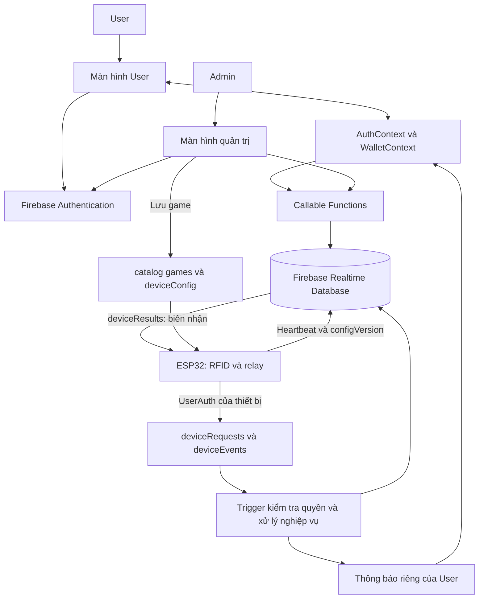

# BÁO CÁO KIẾN TRÚC ỨNG DỤNG DI ĐỘNG SMARTPLAYCARD

Cập nhật ngày 09/10/2026 theo mã nguồn sau khi triển khai các luồng Admin–User–ESP32. Báo cáo phân biệt tính năng đã viết trong workspace với tính năng đã được vận hành trên Firebase/phần cứng thật. Hướng dẫn đưa hệ thống vào sử dụng: [Triển khai đồng bộ](TRIEN_KHAI_DONG_BO.md).

## 1. Tổng quan

SmartPlaycard quản lý thẻ RFID, số dư và việc sử dụng máy trò chơi tại các chi nhánh. Admin quản lý game, thiết bị, chi nhánh, liên kết thẻ với tài khoản và xử lý hỗ trợ; User xem dữ liệu thẻ của mình, game, lịch sử, thông báo và hồ sơ. ESP32 nhận diện thẻ, gửi yêu cầu nghiệp vụ và phát xung relay sau khi backend xác nhận giao dịch.

Ứng dụng không còn đăng nhập tài khoản cố định, adapter demo hay chức năng nạp mô phỏng. Màn hình không tự tạo dữ liệu mẫu khi chưa có dữ liệu thật. Firebase Authentication xác thực tài khoản; Cloud Functions kiểm tra quyền và xử lý các thay đổi tiền. Việc bỏ demo trong mã nguồn không đồng nghĩa đã tự xóa hoặc đối soát số dư mô phỏng còn tồn tại từ các phiên bản trước.

## 2. Công nghệ

| Thành phần | Phiên bản khai báo | Vai trò |
| --- | --- | --- |
| Expo | `^58.0.20` | Công cụ phát triển và module nền tảng |
| React Native | `0.88.0` | Giao diện Android/iOS |
| React | `19.3.0` | Component, hook và Context |
| Expo Router | `~58.0.27` | Stack, Tabs và route theo tệp |
| TypeScript | `~6.0.3` | Kiểu dữ liệu và kiểm tra mã |
| Firebase JS SDK | `^12.19.0` | Authentication và Callable Functions |
| Firebase Admin SDK | `^13.0.0` | Truy cập database từ backend tin cậy |
| Firebase Functions | `^6.0.0` | Callable, trigger RTDB và scheduler |
| AsyncStorage | `2.2.0` | Phiên Firebase trên native và lựa chọn thẻ theo tài khoản |
| ESP32 / FirebaseClient | Core `3.3.1` / library `2.2.13` trong bộ build kiểm tra | RFID, kết nối được xác thực và relay |

Đã đọc [tài liệu Expo SDK 57](https://docs.expo.dev/versions/v57.0.0/) trước khi thay đổi mã. Bản export web/Android là bundle; không thay thế kiểm tra APK trên điện thoại.

## 3. Kiến trúc tổng thể



Kiến trúc phân lớp gồm UI, Context, service client, backend nghiệp vụ và kho dữ liệu. Các màn hình User nhận dữ liệu từ WalletContext; Context gọi `userSnapshot`. Màn hình Admin gọi các dịch vụ quản trị. Phần cứng dùng giao thức request/result thay vì trực tiếp thay đổi số dư.

Phần lớn dữ liệu hiển thị được làm mới tuần tự bằng polling: User mỗi 10 giây, Admin vận hành mỗi 30 giây và bảng Game/Thẻ/Hỗ trợ mỗi 10 giây khi mở. Không mô tả cơ chế này là push liên tục hoặc thông báo nền khi app đóng.

## 4. Tổ chức mã nguồn

```text
src/app/                       Đăng nhập, Tabs và các màn hình bổ sung
  games.tsx                    Game do Admin công bố, lọc chi nhánh
  notifications.tsx            Thông báo và đánh dấu đã đọc
  personal-info.tsx            Hồ sơ thật của tài khoản
  support.tsx                  Liên hệ và yêu cầu hỗ trợ hai chiều
  terms.tsx                    Điều khoản dạng văn bản
src/components/admin/          Dashboard cũ và bảng Game/Thẻ/Hỗ trợ mới
src/contexts/                  AuthContext và WalletContext
src/services/platform.ts       Hợp đồng dữ liệu và Callable client
src/services/firebase/auth*    Auth dùng chung cho Admin/User, persistence theo nền tảng
admin-backend/platform.cjs      Callable và trigger cho các luồng mới
admin-backend/device-money.cjs  Logic tiền phía server cho ESP32
admin-backend/platform-core.cjs Validation và kiểm tra phạm vi
admin-backend/index.cjs         Khởi tạo và quản trị vận hành/báo cáo
admin-backend/database.rules.json Bộ Rules đầy đủ, mặc định đóng
firmware/SMARTTAP/              RFID, NVS, UserAuth và relay
scripts/                       Test nghiệp vụ và Security Rules
```

Các file demo, facade RFID cũ và service nạp mô phỏng đã được loại bỏ. Các parser/read service Firebase cũ còn được giữ để kiểm tra dữ liệu và tương thích mã, nhưng luồng UI mới dùng Callable Functions.

## 5. Xác thực và phân quyền

AuthContext theo dõi phiên Firebase thật, gọi `platformSession` để xác định vai trò và điều hướng tới Admin hoặc Tabs User. Khi backend không trả được vai trò, app hiển thị lỗi và cho thử lại; không tự cấp quyền hoặc rơi về dữ liệu demo.

Vai trò Admin được tra từ `admin/operations/access/{authUid}` trên server, không tin role từ UI. User chỉ đọc thẻ có `ownerAuthUid` khớp tài khoản. Nhập UID không tạo quan hệ sở hữu. Việc liên kết thẻ là thao tác Admin, có kiểm tra phạm vi chi nhánh.

Mỗi ESP32 dùng tài khoản riêng, được cấp quyền qua `deviceAccess`/`deviceProvision`. Rules cho thiết bị đọc thẻ trong chi nhánh và cấu hình của chính máy, ghi request/sự kiện bất biến và telemetry của chính máy. Không cho SDK client ghi số dư, transaction, ledger, hồ sơ hay kho hỗ trợ trực tiếp; các luồng đó qua server.

Tài khoản thiết bị bị từ chối khi đăng nhập ứng dụng. Quyền cashier chỉ cấp cho phần cứng thu ngân do nhân viên vận hành.

## 6. Mô hình dữ liệu và nghiệp vụ tiền

Dữ liệu chính gồm `cards`, `cardHistory`, `catalog`, `userData`, `support`, `deviceAccess`, `deviceProvision`, `deviceRequests`, `deviceResults`, `deviceEvents`, `devices` và namespace quản trị `admin`. Chi tiết schema tại [FIREBASE.md](FIREBASE.md).

Backend cập nhật số dư và biên nhận `_operations/{requestId}` trong cùng transaction của thẻ. Giao dịch trùng ID được đối chiếu và trả lại biên nhận, không cộng/trừ tiền lần nữa. Lịch sử và ledger là projection có thể khôi phục bằng retry.

Nạp tiền thật hiện qua quầy: Super Admin/Kế toán xác nhận số tiền đã thu và số biên nhận, hoặc thiết bị được cấp quyền cashier gửi yêu cầu. Backend tạo ID ổn định theo chi nhánh và số biên nhận để retry sau khi mở lại app không nạp trùng. User không có nút tự cộng tiền.

Ledger xác nhận tiền mặt do backend tạo; giao dịch mô phỏng không được đưa vào doanh thu. Chưa có payment provider, webhook ngân hàng hay hoàn tiền tự động. Thời gian transaction/heartbeat dùng seconds; thông báo/ledger dùng milliseconds. Tiền là số nguyên VND.

## 7. Các yêu cầu bổ sung đã viết trong mã nguồn

| Yêu cầu | Luồng hiện tại |
| --- | --- |
| Admin thêm game sang User | Admin chọn máy thật, chi nhánh, giá/thời lượng; lưu catalog và deviceConfig cùng transaction. User thấy game được bật. Máy xác nhận configVersion trước khi đánh dấu sẵn sàng |
| Chi nhánh của thẻ | Admin gán chi nhánh và chủ thẻ; User xem tên chi nhánh. Không suy ra vị trí hiện tại của thẻ |
| Nhận diện thẻ | ESP32 phát CARD_READ; backend gửi thông báo cho User đã liên kết |
| Chơi game và lỗi | Sau biên nhận thành công, relay gửi xung; có chân phản hồi mới phát SESSION_STARTED/ENDED. Lỗi/timeout hoặc mất kết nối trong phiên liên quan tạo thông báo hỗ trợ |
| Nhận tiền | Receipt TOPUP thật được chuyển thành lịch sử và thông báo, có chống trùng |
| Thông tin cá nhân | Họ tên/điện thoại lưu theo Auth UID; tên tài khoản/ngày tham gia lấy từ Firebase Auth; đổi mật khẩu cần mật khẩu hiện tại; User không sửa quyền/số dư |
| Điều khoản | Màn hình văn bản có thể cuộn, nội dung sử dụng thông thường tại khu vui chơi |
| Liên hệ hỗ trợ | Hiển thị 0794088678 và 0708348573, nút gọi và số có thể sao chép |
| Hỗ trợ hai chiều | User gửi vấn đề; Admin đúng phạm vi nhận badge yêu cầu mới, trả lời/cập nhật trạng thái; User thấy phản hồi và thông báo |

Thông báo có trạng thái đã đọc. Lịch sử User hiển thị 100 giao dịch gần nhất từ projection; hộp thư hiển thị 100 thông báo gần nhất. Snapshot thẻ, game và hỗ trợ có giới hạn, vượt ngưỡng báo lỗi thay vì im lặng hiển thị tổng thiếu.

## 8. Phần cứng và tình huống lỗi

Relay mặc định GPIO 26, mức HIGH, xung 100 ms; các tham số nằm trong cấu hình cục bộ. GPIO này chưa được dùng bởi RC522, màn hình hay ba nút trong firmware hiện tại. Chưa xác nhận đấu dây hoặc mức kích của module relay thực tế.

Không có chân phản hồi được cung cấp, nên mặc định hai chân phản hồi là `-1`. Với cấu hình đó, app chỉ thông báo đã gửi xung và hết thời lượng dự kiến. Người vận hành có thể cấu hình tín hiệu running/error để nhận xác nhận bắt đầu, kết thúc và lỗi thật.

Request đang chờ và hàng đợi sự kiện được lưu trong NVS. ID đã xử lý được ghi trước xung; mất điện quanh thời điểm xung không làm tự phát lại. Trường hợp không rõ máy có nhận xung hay chưa cần nhân viên đối soát. Không tự coi trừ tiền là bằng chứng trò chơi đã bắt đầu.

## 9. Kiểm tra và phần còn cần cấu hình thật

- TypeScript và ESLint: đã đạt tại workspace.
- 36 test: đã đạt, gồm định danh tên tài khoản, quyền, sở hữu thẻ, cấu hình game, hồ sơ, hỗ trợ, receipt tiền và retry. Test dùng fixture trong bộ nhớ, không phải dữ liệu demo của app.
- Export web và Android Hermes: đã đạt.
- Bộ test Security Rules đã viết; chưa chạy do máy thiếu Java và yêu cầu tải Java bị từ chối.
- Firmware cuối biên dịch thành công với ESP32 core 3.3.1: flash 89%, RAM tĩnh 15%. Bundle web/Android đã xuất trước chỉnh sửa giao diện cuối; lượt xuất lại web chưa chạy vì yêu cầu bị từ chối.
- Chưa đăng nhập Firebase CLI/ADC để deploy Functions/Rules, chưa xác minh tài khoản thật, chưa nạp firmware hoặc thử relay trên phần cứng.

Để vận hành cần cấu hình Firebase Auth, bootstrap Admin, triển khai backend/Rules, cấp quyền từng ESP32, điền cấu hình firmware, kiểm thử relay và đối soát dữ liệu cũ. Không thể xác nhận hệ thống production hoạt động chỉ từ việc bundle hoặc test đạt.

## 10. Căn cứ

- [AuthContext](../src/contexts/auth-context.tsx), [WalletContext](../src/contexts/wallet-context.tsx), [client platform](../src/services/platform.ts).
- [Giao diện Admin](../src/components/admin/admin-app.tsx), [bảng Game/Thẻ/Hỗ trợ](../src/components/admin/platform-admin-panel.tsx).
- [Backend mới](../admin-backend/platform.cjs), [nghiệp vụ tiền phần cứng](../admin-backend/device-money.cjs), [Rules](../admin-backend/database.rules.json).
- [Firmware](../firmware/SMARTTAP/SMARTTAP.ino), [đồng bộ và relay](../firmware/SMARTTAP/SmartTapSync.h), [request/result](../firmware/SMARTTAP/SmartTapAtomic.h).
- [Test platform](../scripts/platform.test.cjs), [test Rules](../scripts/database-rules.test.cjs), [hướng dẫn triển khai](TRIEN_KHAI_DONG_BO.md).
